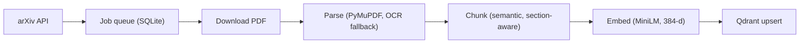
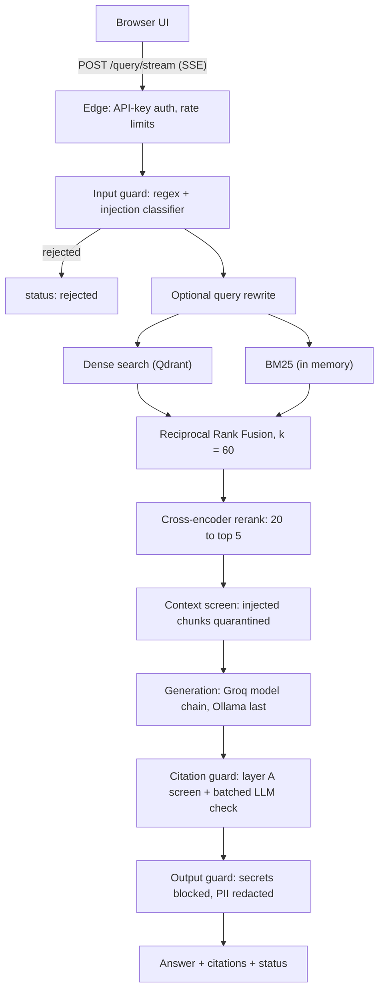

# Autonomous Research Agent

**Citation-grounded question answering over 99 arXiv papers.** Hybrid retrieval, cited answers, a layered citation check, and limits that are measured and published.

[](https://re-451aa458cd8c43b89140b0dd941e5956.ecs.ap-southeast-2.on.aws/)


**Live demo:** <https://re-451aa458cd8c43b89140b0dd941e5956.ecs.ap-southeast-2.on.aws/>
(prototype, hosted on AWS ECS using free promotional credit; a typical answer takes about 9 to 13 seconds on a CPU laptop, and latency on ECS has not been measured yet, see [section 6](#6-deployment-and-end-note))

## Contents

1. [Product and problem statement](#1-product-and-problem-statement)
2. [Features and solution characteristics](#2-features-and-solution-characteristics)
3. [Setup guide](#3-setup-guide)
4. [Architecture](#4-architecture)
5. [Evaluation scores](#5-evaluation-scores)
6. [Deployment and end note](#6-deployment-and-end-note)

---

## 1. Product and problem statement

`PRODUCT` `PROBLEM` `SCOPE`

### Product
A web page, "Ask the literature". A researcher types a question, optionally filters by arXiv category, section, author, paper or date,
and receives a short answer streamed from an LLM. Each sentence is tagged `[1]`, `[2]`, ... and each tag links to the exact passage it came
from: paper title, section, page and the arXiv link. Thumbs up, thumbs down and "wrong citation" buttons send feedback.

### Problem
RAG systems fail in a particular way: they give a **confident answer with a plausible-looking citation that does not support it**.
A wrong answer with a real-looking `[3]` is worse than no answer, because the citation invites trust.

### Approach
1. Constrain generation to a small set of numbered source passages, and require a `[N]` on every claim.
2. Screen each cited sentence against the passage it cites before the user sees it.
3. When a check cannot run or most of an answer fails it, say so on the page instead of showing a silent "verified".

### Scope
| | |
|---|---|
| Corpus | 99 arXiv papers (machine learning, NLP and information retrieval; 2014 to 2026), 19,116 passages |
| Built for | Researchers who want answers they can trace to a source |
| Not built for | General knowledge questions, medical or legal use, or large user counts (capacity is limited by a free LLM tier) |
| Honest status | A filter for **mechanical** errors (wrong numbers, names, citations), not a guarantee of faithfulness. See [section 5](#5-evaluation-scores) |

PDFs are not redistributed in this repository; every citation links to arxiv.org.

---

## 2. Features and solution characteristics

`RETRIEVAL` `CITATIONS` `GUARD` `SAFETY` `RELIABILITY` `OPERATIONS`

| Area | What it does |
|---|---|
| **Hybrid retrieval** | Dense search (Qdrant, MiniLM 384-d) plus BM25 keyword search, fused with Reciprocal Rank Fusion (k = 60), then re-ranked by a cross-encoder (20 candidates to top 5) |
| **Server-side filters** | Category, section, author, paper id and date range are pushed down to Qdrant (5 payload indexes) |
| **Provenance** | Every chunk stores arXiv id, version, page, section and character offsets; citations link to the arXiv page and PDF page |
| **Cited answers** | Prompt forces `[N]` on each sentence; sentences without a valid citation are removed |
| **Layered citation guard** | (A) overlap floor and a "specifics" gate: every number, acronym and name must appear in the cited chunk; (B) one batched LLM entailment check. Honest hedges ("the sources do not say...") pass through |
| **Honest degradation** | If the LLM check cannot run, the answer is shown with a visible `lexical_only` warning. If generation fails twice, status `unverified`. If Qdrant is down, HTTP 503, never an invented answer |
| **"Not sure" status** | If more than half of an answer's sentences fail the guard, the original answer is shown tagged "Not sure" with its sources |
| **Safety layers** | Prompt-injection screening of the query and of retrieved paper text; secrets in output are blocked; email, phone, SSN and card numbers are redacted |
| **Access control** | Optional API keys, per-user per-minute and per-day limits, brute-force throttle, query length cap |
| **Resilient ingestion** | SQLite job queue: resumable, retries, version-aware dedup, OCR fallback for scanned PDFs |
| **Operations** | Streaming (SSE), JSONL query log, `/metrics` (p50/p95, status counts), `/health`, Qdrant snapshot with a tested restore drill |
| **Quality gates** | 440 offline tests, 16 failure-injection tests, an opt-in live end-to-end suite (10 tests), CI with a RAGAS regression gate (provisional thresholds) |
| **LLM routing with fallbacks** | Groq model chain (`gpt-oss-120b`, `gpt-oss-20b`, `qwen3.8-27b`), each with its own free quota, then local Ollama (`qwen2.5:1.5b`) as the last resort |

### Response statuses
| Status | Meaning |
|---|---|
| `ok` | Answer shown; unsupported or uncited sentences removed (`hedged: true` if it is an honest "the sources don't say") |
| `low_confidence` | More than half the sentences failed; original answer shown, tagged "Not sure" |
| `unverified` | Generation failed twice; top passages shown with a warning |
| `abstained` | Retrieval found nothing |
| `rejected` | Prompt injection caught at the input |
| `blocked` | Credential-shaped output withheld |

> `ok` is **not** a verification stamp. In a human-labelled sample the status did not track correctness (see [section 5](#5-evaluation-scores)).

---

## 3. Setup guide

`PREREQUISITES` `INSTALL` `CONFIGURE` `DATA` `RUN` `TEST`

### Prerequisites
- Python 3.12
- A [Groq](https://console.groq.com) API key (free tier is enough for a demo)
- Optional: Docker, Ollama (`ollama pull qwen2.5:1.5b`) for the local fallback, Tesseract (for scanned PDFs when ingesting)
- About 2 GB of free RAM at runtime (1.5 to 2 GB, an estimate)

### Install
```bash
git clone https://github.com/Tinaprabhat/Autonomous-Research-Agent.git
cd Autonomous-Research-Agent
python -m venv .venv && source .venv/bin/activate     # Windows: .venv\Scripts\activate
pip install -r requirements-dev.txt
```

### Configure
```bash
cp .env.example .env          # Windows: copy .env.example .env
```
| Variable | Purpose |
|---|---|
| `GROQ_API_KEY` | LLM provider (required) |
| `QDRANT_URL`, `QDRANT_API_KEY` | Qdrant Cloud or Docker. **Leave empty** to use embedded local storage in `data/qdrant_local` |
| `QDRANT_FORCE_LOCAL=1` | Use local storage even when a URL is set |
| `API_KEYS="name:key[:per_minute[:per_day]],..."` | Turns authentication on (keys at least 16 characters). Empty = open API |
| `GUARD_ENTAILMENT` | `llm` (default) or `off` (layer A only) |

Never commit `.env` (it is git-ignored). Load secrets from your platform's secret store in production.

### Get the data
The Qdrant index and PDFs are **not** in the repository (`data/` is git-ignored). Pick one:

```bash
# A. Build it yourself (resumable; downloads about 100 papers, respects arXiv's 3 s rate limit)
python scripts/ingest_papers.py --local harvest --max-papers 100
python scripts/ingest_papers.py --local run
python scripts/ingest_papers.py --local status

# B. Restore a snapshot into a new collection
python scripts/qdrant_backup.py restore backups/<snapshot-file> --target papers

# C. Point QDRANT_URL / QDRANT_API_KEY at an existing cluster that already holds the `papers` collection
```

### Run
```bash
python scripts/ask.py --local "How does MAML adapt to a new task?"     # terminal
uvicorn backend.app.api:app --port 8000                                # UI at http://localhost:8000
```
The first start builds the keyword index from Qdrant and loads three local models: 25 to 55 seconds for the pipeline, up to about 3 minutes
for the full app (measured on a CPU laptop).

### Docker
```bash
docker build -t research-agent .
docker run -p 7860:7860 --env-file .env research-agent      # UI at http://localhost:7860
```

### Test
```bash
python -m pytest -m "not slow"          # offline suite (fakes; never touches cloud services)
python -m pytest -m slow                # runs the injection classifier locally
python -m pytest -m live tests/live     # opt-in end-to-end test: real models, real Qdrant (read-only), real Groq
```

### Backups
```bash
python scripts/qdrant_backup.py drill       # snapshot, restore into a scratch collection, verify, clean up
```

---

## 4. Architecture

`INGESTION` `SERVING` `STORAGE` `OPERATIONS`

### Ingestion (offline, resumable)


### Serving (one request)


### Key parameters
| Item | Value |
|---|---|
| Chunking | 500 characters max, 70 overlap, never across sections, References dropped, minimum 80 characters |
| Chunk id | `{arxiv_id}_{version}_{index}` (unique across papers) |
| Vector store | Qdrant, 384-d cosine, HNSW m = 16, ef_construct = 100, no quantization |
| Candidate pool | 30 per ranker, 20 after fusion, top 5 after rerank |
| Embedder / reranker | `all-MiniLM-L6-v2` / `cross-encoder/ms-marco-MiniLM-L-6-v2` |
| Injection classifier | `protectai/deberta-v3-base-prompt-injection-v2` (0.85 on queries, 0.999 on retrieved text) |
| Generation | temperature 0, max 400 tokens, retry once, then `unverified` |
| Guard thresholds | overlap floor 0.3; all numbers, acronyms and names must appear in the cited chunk |

### API
| Method | Path | Purpose |
|---|---|---|
| GET | `/` | The web page |
| GET | `/health` | `ok`, `loading` or `degraded` |
| GET | `/me` | Caller's limits and remaining daily queries |
| GET | `/papers` | Papers and filter options |
| POST | `/query`, `/query/stream` | Ask a question (JSON, or server-sent events) |
| POST | `/feedback` | Thumbs up, thumbs down, wrong citation |
| GET | `/metrics` | Query counts, p50/p95 latency, status counts |

When `API_KEYS` is set, every route except `/`, `/health` and the docs needs `X-API-Key` or `Authorization: Bearer`.

### Stack
FastAPI, uvicorn, Qdrant, `rank-bm25`, sentence-transformers, PyMuPDF (+ Tesseract), Groq, Ollama, RAGAS, pytest, Docker, AWS ECS.

### Repository layout
```
backend/app/    api, auth, config, pipeline, services
  ingestion/    arxiv_fetcher, pdf_parser, chunking, job_queue, worker
  storage/      qdrant_store, backup
  retrieval/    embedder, hybrid_retriever, reranker, query_rewriter
  citations/    guard, llm_verifier, formatter
  llm/          groq_llm, local_llm, router
  safety/       guardrails
  telemetry/    observability
frontend/       Research_ui.html
eval/           evaluation code, golden set, reports
scripts/        ingest_papers, ask, sync_to_cloud, qdrant_backup, download_models
tests/          offline suite, failure injection, live end-to-end, RAGAS CI gate
docs/           architecture, known_limits, case_study
```
More detail: [docs/architecture.md](docs/architecture.md) and the reference numbers in [docs/info.md](docs/info.md).

---

## 5. Evaluation scores

`PROJECT METRICS` `RETRIEVAL` `HUMAN-LABELLED` `RAGAS` `TESTS`

> **How to read these numbers.** Every figure was measured on this repository's own runs. The human-labelled sample is small
> (30 answers, one labeller), so intervals are wide and are shown. Reference answers are machine-written. The LLM judge is the same
> model family as the generator, so judge scores are likely optimistic.

### Project metrics at a glance
| Metric | Value | Note |
|---|---|---|
| Project size | 99 papers indexed into 19,116 chunks | Qdrant snapshot 99.6 MB; local embedded store about 87 MB. **Docker image size not measured** |
| Latency (CPU laptop) | Typically 9 to 13 s per query | 10-query live sample: p50 12.9 s, p95 48.9 s. Slow Qdrant Cloud responses drove some outliers |
| Faithfulness (RAGAS) | **0.937** (95% CI 0.862 to 0.995) | 30 guarded answers. A rough, potentially optimistic estimate: the judge missed 3 of 5 known unfaithful answers |
| Correctness (RAGAS) | **0.532** (95% CI 0.372 to 0.708) | Likely an underestimate: terse references caused exact-zero scores for some correct answers |
| Completeness (RAGAS) | **0.783** (95% CI 0.650 to 0.900) | Share of reference claims covered |
| Precision@5 | **0.183** over 80 answerable questions | Each question has one gold chunk, so the maximum is 0.20; recall@5 was 0.912 |

### Retrieval (80 answerable questions, k = 5)
| Configuration | Recall@5 | Precision@5 | MRR | Paper recall@5 |
|---|---|---|---|---|
| Dense only | 0.750 | 0.150 | 0.627 | 0.963 |
| BM25 only | 0.900 | 0.180 | 0.830 | 0.988 |
| Hybrid (RRF) | 0.887 | 0.178 | 0.722 | 0.988 |
| **Hybrid + rerank** | **0.912** | **0.183** | **0.856** | **1.000** |

Read precision@5 with care: each golden question has exactly one gold chunk, so precision@5 can never exceed 1/5 = 0.20. Hybrid + rerank
reaches 0.183, which is 91% of that ceiling, and it equals recall divided by 5, so it adds no information beyond recall@5. RRF alone lowers MRR
relative to BM25; the cross-encoder repairs it. The golden questions were written from the gold passage's own wording, which favours BM25.
Unanswerable questions: 19 of 20 (95%) correctly refused, measured with an earlier guard version and not re-run.

### Answer quality (30 human-labelled answers, 95% intervals)
| Measure | Result |
|---|---|
| Raw answers containing an unsupported claim | **5 / 30 = 16.7%** (7.3 to 33.6%) |
| Same, after the guard, among answered responses | 12.0% to 16.0% across two identical replays (intervals about 4 to 35%) |
| Answer rate / false-refusal rate | 83.3% (66.4 to 92.7%) / 3.3% (0.6 to 16.7%) |
| Correct answers wrongly tagged "Not sure" | 16.0% (6.4 to 34.7%) |
| Guard on real errors | Fixed or flagged 1 to 2 of 5 (the verifier is not deterministic) |
| Does the "Not sure" tag track correctness? | **No** (guard-score AUROC 0.49) |

**Reading it honestly:** the guard catches mechanical errors (in a stress test of 201 mutated sentences it dropped all number swaps,
conflations and wrong-chunk citations) but it has **not been shown to lower the error rate on real answers**. It missed an unstated inference
and a conflation of two facts. Treat it as a filter, not a proof.

### RAGAS (30 guarded responses, judge `gpt-oss-120b`)
| Metric | Score | 95% CI |
|---|---|---|
| Faithfulness | 0.937 | 0.862 to 0.995 |
| Hallucination (1 − faithfulness) | 0.063 | 0.005 to 0.138 |
| Completeness (share of reference claims covered) | 0.783 | 0.650 to 0.900 |
| Correctness (a lower bound) | 0.532 | 0.372 to 0.708 |

RAGAS faithfulness flagged only 2 of the 5 human-labelled unfaithful answers (it missed 3) and falsely flagged 3 of 25 faithful ones (AUROC 0.63,
interval includes chance). It replaced DeepEval, which scored all 30 answers 1.0. Correctness is an underestimate because terse reference answers
penalise correct answers that restate the question's context.

### Tests
| Suite | Result |
|---|---|
| Offline | 440 passed, 0 failed (12 slow classifier tests deselected) |
| Live end-to-end (real models, Qdrant read-only, real Groq) | 10 / 10 passed in 112 s |
| Failure injection | 16 tests (LLM down, Qdrant down, malformed PDFs, ...) |
| Qdrant restore drill | Passed: 19,116 / 19,116 points identical, 20 / 20 queries returned the same top 5 |

Reference numbers and what was **not** measured: [docs/info.md](docs/info.md). How the numbers were obtained, including every problem hit: [docs/case_study.md](docs/case_study.md). Standing list of weaknesses: [docs/known_limits.md](docs/known_limits.md).

---

## 6. Deployment and end note

`AWS ECS` `LATENCY` `SIZE` `LIMITS`

**Deployed on AWS ECS (region ap-southeast-2):** <https://re-451aa458cd8c43b89140b0dd941e5956.ecs.ap-southeast-2.on.aws/>

| | |
|---|---|
| Platform | AWS ECS, container built from this repository's `Dockerfile` (port 7860) |
| Hosting cost | Paid from a **US$100 AWS free-credit** balance; not free-tier hosting, so the demo runs only while credit lasts |
| ECS task size | **TBD** (vCPU / memory) |
| Container image size | **Not measured** |
| Runtime memory | 1.5 to 2 GB (estimate); start-up 25 to 55 s for the pipeline, up to about 3 min for the full app |
| Latency on ECS | **Not measured** |
| Latency measured locally (CPU laptop) | Typical 9 to 13 s; p50 12.9 s, p95 48.9 s over 10 logged queries (2026-10-15) |
| Where the time goes | LLM calls take about 1.5 to 2 s; the injection screen, cross-encoder and Qdrant round trips dominate |
| Data sizes | 99 papers (237 MB of PDFs, not in the repo), 19,116 chunks, parsed chunks 14.5 MB, Qdrant snapshot 99.6 MB |
| Demo access | **TBD** (open, or API key on request) |
| Capacity | Free Groq tier: 8,000 tokens/min and 200,000 tokens/day per model; roughly 300 answered queries per day across the model chain (estimate) |
| Cost | LLM and vector database: free tiers. AWS hosting: covered by the US$100 credit |

**Known limits of this deployment:** single task (a redeploy means about three minutes of downtime), in-memory rate limits and quotas, static API
keys, free-tier LLM throughput, and logs that live on the container's ephemeral disk.

**What is not measured:** latency on the deployed host, Docker image size, ingestion time end to end, the guarded pipeline over the other 50
answerable questions, and human-judged relevance and completeness.

---

Built by **Tina Prabhat**, B.Tech Computer Science, KIIT University.
License: MIT.
